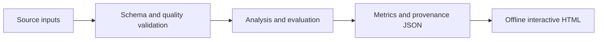

# Architecture and engineering decisions

**Project flow:** Saved episode records --> schema + score validation --> full-window criterion + block bootstrap --> interactive audit.

## Design decisions

### Score audit independent of training
The audit validates consecutive episode IDs, finite agent returns, the max-agent episode score and truncation flags. A complete window of 100 nontruncated episodes is required before a training window can qualify.

### Reproducible agent state
Replay and exploration have their own random generators. Constructing another buffer or drawing from NumPy’s global generator no longer changes their sequences. Replay owns copies of its inputs, preventing caller-side mutation from corrupting stored experience. These changes alter future random sequences; they do not change the saved historical scores.

### Portable inference
The actor checkpoint loads on CPU with strict state matching and weights-only loading. Observations must be finite batches of 24 features. The graph export supports batches of 1–1,024 and writes source/artifact fingerprints with its interface metadata.

## Failure behavior

Schema errors, invalid analysis inputs and insufficient cohorts fail with an explicit command-line error and a nonzero exit status. Results serialize as strict JSON; non-finite values cannot silently enter the report. The HTML renderer escapes embedded JSON and writes chart labels as text. Reports make no external script, analytics or data requests.

## Source layout

- `src/tennis_control/` contains the implementation and report renderer.
- `tests/` covers data/model invariants and report consistency.
- `docs/` contains a generated real-data report and its machine-readable results.
- `.github/workflows/ci.yml` runs checks on Python 3.11 and 3.12.

## Public artifacts

Raw restricted datasets are never embedded in the reports. Public outputs contain analytical aggregates and source fingerprints. Input filenames appear in the reproducibility record; local directories do not. Source/provider terms are documented separately in `DATA.md`.
