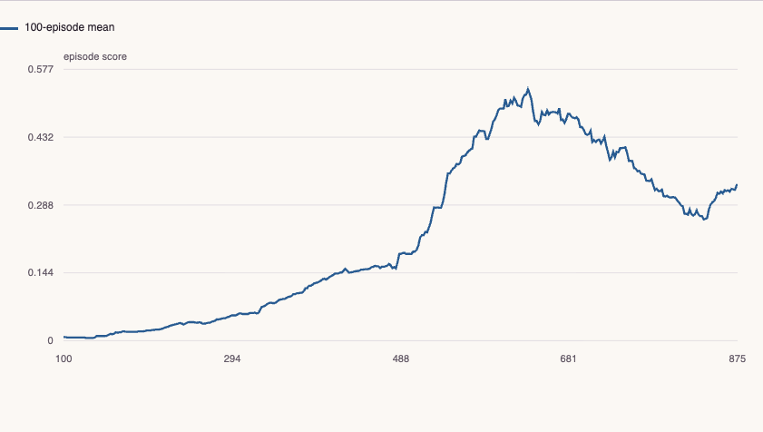

# Shared-Policy Continuous Control

A two-agent DDPG implementation with saved policies, independently audited score records, reproducibility fixes and portable CPU inference.

**[Open the interactive report](https://feraselghandour.github.io/tennis-reinforcement-learning/)** · [Architecture](ARCHITECTURE.md) · [Methods and validation](VALIDATION.md)

[](https://github.com/FerasElghandour/tennis-reinforcement-learning/actions/workflows/ci.yml)

## What the evidence shows

The saved policy achieved a **2.067 mean score over 100 evaluation episodes** with learning and exploration disabled. The score audit independently validates the episode definition and the full-window solving criterion.

| Measure | Result |
|---|---|
| Recorded training episodes | 875 |
| First qualifying 100-episode window | Ends at episode 607 |
| Saved-policy evaluation | 100 episodes; mean score 2.067 |
| Sequence-level block-bootstrap interval | 1.758–2.349; blocks of ten episodes |
| Policy interface | 24 input features → 2 bounded continuous actions |

The interactive report includes selectable comparisons, a matching numerical table, CSV/JSON downloads and the reproducibility record. It also works offline: download `docs/index.html` and open it in a browser.

[](https://feraselghandour.github.io/tennis-reinforcement-learning/)

## Engineering

- Strict transition and observation validation before replay mutation.
- Independent random generators for exploration noise and replay sampling; replay stores defensive copies.
- Inference preserves the model’s train/evaluation mode; learning records finite actor/critic losses.
- A separate score-audit CLI and CPU policy inference/export CLI, without requiring Unity for those tasks.

The implementation is packaged under `src/tennis_control/`; `Report.md` contains the algorithm and historical experiment detail. Small root-level entry points preserve existing commands.

## Reproduce

Use Python 3.11 or later and a separate virtual environment for this repository.

```sh
python -m venv .venv
. .venv/bin/activate
python -m pip install -e ".[dev]"
python -m tennis_control --run run-seed-0 --output reports
python -m pytest -q
```

The score records are included. The audit runs without Torch or Unity. Install the optional agent dependencies for policy inference and export; see below.

Each run writes `index.html` and `metrics.json` to the chosen output directory. The JSON records the measured results, input SHA-256 fingerprints, source-code fingerprints, dependency versions and analytical settings. To use the notebooks, install the optional `notebooks` dependencies.

## Run the saved policy

```sh
python -m pip install -e ".[agent,dev]"
tennis-policy --checkpoint run-seed-0/checkpoint_actor.pth --observations observations.json
tennis-policy --checkpoint run-seed-0/checkpoint_actor.pth --export exports/actor.pt2
python verify_agent.py
```

`observations.json` must contain environment observations as a JSON array with shape `[batch, 24]`. The output has two actions per observation, each in `[-1, 1]`. The export includes interface metadata and source/artifact hashes. Exported programs are framework-version dependent; validate parity in the intended runtime.

For new environment runs, use the separate legacy Linux/Python 3.11 setup in [MODEL_CARD.md](MODEL_CARD.md). The environment binary is acquired separately.

## Interpretation

The critic uses each agent’s local observation and action. The legacy class name `MADDPGAgent` does not imply a centralized critic. Scores come from one historical training seed and one evaluation sequence. The block-bootstrap interval is conditional on that sequence, not a multi-seed performance guarantee. Engineering updates have not been presented as a new environment benchmark.

## Portfolio

- [Weather-Aware Bike-Share Demand Analysis](https://github.com/FerasElghandour/bikeshare-weather-analysis)
- [Bike-Share Customer Behavior](https://github.com/FerasElghandour/bikeshare-customer-behavior)
- [Movie Revenue: Selection, Sensitivity & Uncertainty](https://github.com/FerasElghandour/movie-revenue-analysis)

---

**Feras Elghandour** · [GitHub](https://github.com/FerasElghandour)  
Data sources and applicable license notices: [DATA.md](DATA.md).
