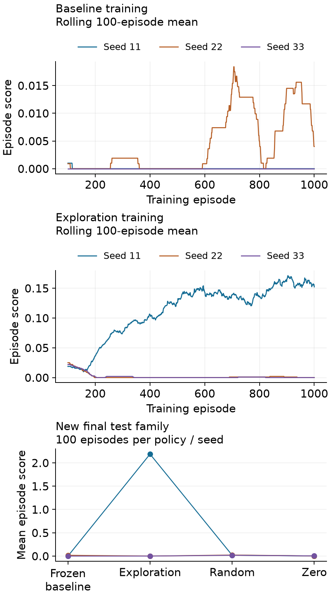
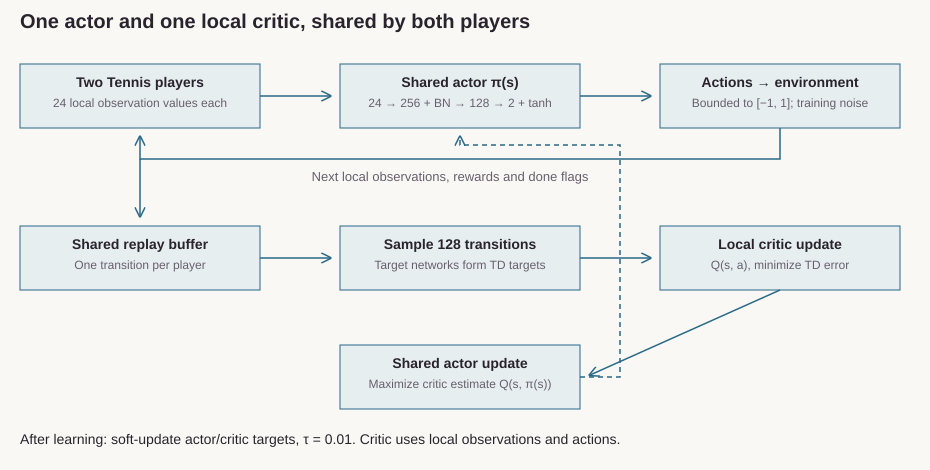

# Shared-Policy Continuous Control

Train one continuous-control policy for two Tennis players, with a local critic, replay learning and portable saved-policy inference.

[](https://github.com/FerasElghandour/tennis-reinforcement-learning/actions/workflows/ci.yml)

## Fresh model training

**Six fresh training runs**: three seeds for the released baseline and three for a fixed exploration follow-up, each trained for 1,000 Tennis episodes on the M2 Max. Separate validation chooses checkpoints; final tests use 100 episodes per policy and seed.

On the new final-test family, mean scores across three trained policies are **0.7293 exploration**, **0.0056 frozen baseline**, and **0.0197 random**. Exploration's individual means are **2.1878, 0.0000, 0.0000**; it exceeds its matched random baseline in **1/3** seed groups. The exploratory alternative was chosen after baseline failure; three paired seeds are descriptive, and step/compute budgets differ. These results do not establish reliable learning.



The included historical saved actor also completed **300 fresh evaluation episodes**, mean **2.1729**, with no truncations. That is one previously trained actor over three new environment sequences, separate from the six fresh training runs.

[Results, every seed, raw rollouts and portable actors](results/fresh-v1/RESULTS.md) · [Methods and validation](VALIDATION.md).

## Mechanism

Both players share one actor, one local critic and one replay buffer. Each player's 24-value observation maps to two bounded actions. Replay minibatches update the critic against detached target-network estimates, then update the actor to maximize the critic estimate. Soft target updates use τ = 0.01.

<picture>
  <source media="(max-width: 760px)" srcset="assets/shared-policy-mechanism-mobile.svg">
  
</picture>

The critic sees one player's local observation/action pair, not both players' joint state. The legacy `MADDPGAgent` class name does not imply a centralized critic. [Actor/critic](src/tennis_control/model.py) · [Learning and replay](src/tennis_control/maddpg_agent.py) · [Architecture](ARCHITECTURE.md).

## Run the saved policy and checks

```sh
python -m venv .venv
. .venv/bin/activate
python -m pip install -e ".[agent,dev]"
python examples/policy_demo.py
python examples/learn_step.py
python -m pytest -q
python verify_fresh_results.py --results results/fresh-v1
```

The policy example uses two **synthetic observation vectors**, shape `[2, 24]`, and returns bounded `[2, 2]` actions. The learning example creates synthetic transitions and exercises actual replay, actor, critic and target updates. Neither example measures Tennis performance. [Observed policy output](examples/policy_demo-output.json) · [Observed learning output](examples/learn_step-output.json).

For your own valid observations or one of the new actors:

```sh
tennis-policy --checkpoint results/fresh-v1/exploration/seed-11/actor.pt --observations examples/observations.json
```

Fresh simulator training uses a separate Python 3.11.15 [pinned Mac environment](requirements-reference-macos.txt) and the independently acquired official Intel simulator under Rosetta. [Complete commands, source archives and runtime limits](results/fresh-v1/RESULTS.md) · [Acquisition and source credits](DATA.md). No simulator binary is included.

## Historical training record

The preserved original run contains 875 episodes. Its first qualifying rolling-100 training window ends at episode 607; saved checkpoint 634 has rolling mean 0.5338. That actor's original 100-episode evaluation mean is 2.067, with learning and exploration disabled. Training continued afterward and regressed. These historical records are separate from the new campaigns above.

[Interactive historical report](https://feraselghandour.github.io/tennis-reinforcement-learning/) · [Training CSV](run-seed-0/training_scores.csv) · [Original evaluation CSV](run-seed-0/evaluation_scores.csv) · [Checkpoint metadata](run-seed-0/training_result.json). The original sequence's block-bootstrap interval is conditional on that sequence, not a guarantee across training seeds.

## Engineering and limits

Replay owns its transition copies; exploration and replay use independent random generators. Inference preserves model mode. Numerical DDPG tests protect targets, terminal masking, actor gradients and target-state transfers. The legacy client has per-instance pipes, bounded waits and explicit shutdown; the earlier native transport failure remains documented.

The new offline result audit checks score identities, complete budgets, validation-only selection and actor fingerprints. Simulation evidence does not establish real-world control or safety. [Model card and export interface](MODEL_CARD.md).

## Reuse

The original tooling listed in [LICENSING.md](LICENSING.md) is available under [MIT](LICENSE). Upstream Udacity MIT and Unity Apache 2.0 notices remain; simulator, dataset, historical source and checkpoint terms are separate.

[Feras Elghandour — model training, deep learning and autonomous systems](https://feraselghandour.github.io/#work).
