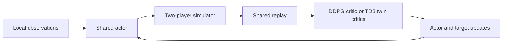

# Tennis Policy Training: DDPG and TD3

Train shared continuous-control policies, compare their behavior across independent seeds and package selected actors for CPU inference.

## Ten new fixed-budget training runs

Five new seeds per pipeline, **40,000 environment interactions each**. Separate validation selects actors; final tests use 100 episodes per policy/training-seed group across two new environment seeds.

| Pipeline | Mean ± sample SD across five policies | Median policy mean | Mean ≥ 0.5 |
| --- | ---: | ---: | ---: |
| DDPG exploration | 1.1008 ± 1.1304 | 0.7344 | 3/5 |
| TD3 / LayerNorm | 0.6427 ± 1.0881 | 0.0840 | 2/5 |

Neither pipeline meets the declared four-of-five criterion for mean score ≥ 0.5.


[All ten runs, every seed and limits](results/robust-v2/RESULTS.md) · [Frozen settings](ROBUSTNESS_PROTOCOL.json) · [Artifact audit](results/robust-v2/verification.json).

## How the models learn

Both players share an actor and replay, with 24-value local observations and two bounded continuous actions. The released DDPG path uses one local critic. The new standard TD3 implementation uses two local critics, a minimum-Q target, target-action smoothing and delayed actor/target updates. Architecture, normalization, noise and compute differ; this is a comparison of complete pipelines.



[DDPG source](src/tennis_control/maddpg_agent.py) · [TD3 source and references](src/tennis_control/td3.py) · [Numerical tests](tests/test_td3_oracles.py). Each critic sees one player at a time. The legacy MADDPGAgent name does not imply a centralized critic.

## Run the saved policy and checks

```sh
python -m venv .venv
. .venv/bin/activate
python -m pip install -e ".[agent,dev]"
python -m pytest -q
python verify_robust_results.py --results results/robust-v2
python robust_policy.py --method td3_layernorm \
  --actor results/robust-v2/td3_layernorm/seed-104729/actor.pt
```

The actor demonstration uses generated zero observations, shape `[2,24]`, unless you supply `--observations examples/observations.json`. It returns bounded `[2,2]` actions and does not measure Tennis performance. Select the matching method for each checkpoint. The existing `tennis-policy`, `examples/policy_demo.py` and `examples/learn_step.py` remain demonstrations of the earlier DDPG interface.

Full simulation training uses the separate Python 3.11.15 [pinned Mac reference](requirements-reference-macos.txt), the official Intel simulator under Rosetta and the fixed commands in the [result report](results/robust-v2/RESULTS.md#reproduce-and-run-the-saved-actors). No simulator binary is redistributed.

## Validation and earlier records

**37 tests pass**, including hand-computed learning oracles and tests that reject altered benchmark evidence. An isolated minimum-to-maximum target mutation is caught by two numerical tests. Every final-test episode, actor fingerprint, validation choice and training budget is retained. [Methods and validation](VALIDATION.md).

The [earlier six-run study](results/fresh-v1/RESULTS.md) used 1,000 episodes per seed and unequal interaction counts. Its exploratory means were 2.1878, 0, 0. The historical actor’s separate 300 new evaluation episodes averaged 2.1729. The [original interactive report](https://feraselghandour.github.io/tennis-reinforcement-learning/) remains historical; these records are separate from the ten new trainings.

Five independent trained policies per pipeline remain a small study. The two pipelines differ beyond their critic update, and simulation results do not establish real-world control. [Model interfaces and scope](MODEL_CARD.md) · [Source and simulator credits](DATA.md).

## Reuse

Eligible original additions are covered by the scoped [MIT grant](LICENSING.md). Preserved Udacity MIT and Unity Apache 2.0 notices, simulator terms and separate checkpoint boundaries remain applicable.

[Feras Elghandour — model training, deep learning and autonomous systems](https://feraselghandour.github.io/#work).
