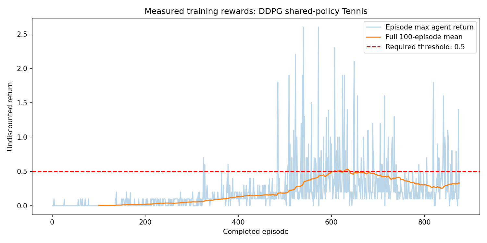

# Multi-Agent Tennis Control

Train two agents to sustain a rally through continuous movement and jumping actions. The implementation combines a shared actor, critic and replay buffer with explicit training records and a separate evaluation of the saved policy.

**Python · PyTorch · NumPy · Unity ML-Agents · Matplotlib**



## Results

| Measure | Result |
|---|---|
| Recorded training episodes | 875 |
| First 100-episode window meeting the 0.5 score threshold | Episode 607; mean 0.510 |
| Saved-policy evaluation | 100 episodes; mean score 2.067 |
| Evaluation settings | Exploration and learning disabled |

## Implementation

- Implemented DDPG with experience replay, target networks, soft updates and exploration noise.
- Shared the policy across agents while keeping each critic input local to an agent’s observation and action.
- Logged episode returns, full 100-episode reward windows, checkpoints and evaluation results.
- Added a learning smoke test covering bounded actions, target gradients and policy save/load equivalence.

## Practical relevance

Demonstrates reinforcement learning for continuous control, model checkpointing and reproducible evaluation. The same engineering disciplines support simulation-based policy experiments and autonomous-control research.

## Explore the project

- `model.py` and `maddpg_agent.py` — actor, critic and learning implementation.
- `Tennis.py` — probing, training and evaluation.
- `verify_agent.py` — learning and checkpoint smoke test.
- `run-seed-0/` — saved policies, score records and training curve.
- `Report.md` — algorithm, architecture and experiment detail.

## Run locally

Use Linux and Python 3.11 for the historical environment setup.

```sh
python -m venv .venv
. .venv/bin/activate
python -m pip install torch==2.5.1 --index-url https://download.pytorch.org/whl/cpu
python -m pip install -r requirements.txt
python verify_agent.py
```

Download and extract the official environment separately, then:

```sh
python Tennis.py --mode probe --env Tennis_Linux_NoVis/Tennis.x86_64
cp -R run-seed-0 run-local-evaluation
python Tennis.py --mode evaluate --env Tennis_Linux_NoVis/Tennis.x86_64 --out run-local-evaluation --eval-episodes 100
```

The copied output folder preserves the published evaluation records. To train a new policy, use `--mode train --out run-new-training`. See `Tennis.py --help` for the remaining arguments. Saved actor/critic weights and the score CSVs are included in `run-seed-0/`.

See [DATA.md](DATA.md) for required inputs and [VALIDATION.md](VALIDATION.md) for the checks and runtime versions.

## Scope

Results come from one seed and one evaluation sequence. The architecture is shared-policy DDPG; the legacy class name `MADDPGAgent` does not imply a centralized critic. The historical environment run used Linux and the legacy Unity v0.4 protocol.

---

**Feras Elghandour** · [GitHub](https://github.com/FerasElghandour)
