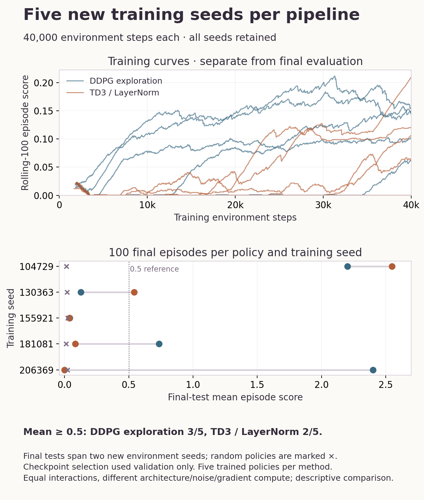

# Equal-interaction Tennis training: ten new runs

**Five new training seeds per pipeline, 40,000 environment steps each.** All ten runs completed on the M2 Max: 400,000 environment interactions, with 800,000 player transitions. Separate validation selected checkpoints. Final testing began only after both campaigns completed, using two new environment seeds and 50 episodes each per policy/training-seed group.

## Held-out results

| Pipeline | Mean ± sample SD across five trained policies | Median policy mean | Policies with mean ≥ 0.5 | Policies beating matched random |
| --- | ---: | ---: | ---: | ---: |
| DDPG exploration | 1.1008 ± 1.1304 | 0.7344 | 3/5 | 5/5 |
| TD3 / LayerNorm | 0.6427 ± 1.0881 | 0.0840 | 2/5 | 4/5 |

Neither pipeline meets the declared four-of-five criterion for mean score ≥ 0.5.

Each reported policy mean contains 100 episodes over two environment initializations. The unit of replication is five independently trained policies per method, not the 500 nested episodes. There are 2,000 final episodes including random and zero controls. No population-level reliability or general algorithm-superiority claim is supported by this small study.



| Training seed | DDPG mean | TD3 mean | Random mean | Zero mean |
| ---: | ---: | ---: | ---: | ---: |
| 104729 | 2.2010 | 2.5490 | 0.0155 | 0.0019 |
| 130363 | 0.1260 | 0.5432 | 0.0195 | 0.0075 |
| 155921 | 0.0408 | 0.0372 | 0.0240 | 0.0028 |
| 181081 | 0.7344 | 0.0840 | 0.0124 | 0.0019 |
| 206369 | 2.4020 | 0.0000 | 0.0235 | 0.0038 |

## What changed and what was controlled

The comparator is the released shared-policy DDPG exploration pipeline: 256/128 BatchNorm actor and local critic, 2,000 uniform-random warmup steps, then OU sigma 0.3. The new independently implemented TD3 path uses a 256/128 LayerNorm actor, two local critics, clipped minimum-Q targets, target-action smoothing, and delayed actor/target updates. It implements the standard [TD3 method](https://arxiv.org/abs/1802.09477), with [OpenAI Spinning Up](https://spinningup.openai.com/en/latest/algorithms/td3.html) as an equation reference; no new algorithm is claimed.

Both players share the actor and replay. Each critic sees one player’s local observation/action pair; neither pipeline uses a centralized joint-state critic. The whole pipelines differ in normalization, initialization, optimizer rates, noise and update compute. Equal environment-interaction budgets do not equalize compute or isolate any single TD3 mechanism.

The source and [settings](../../ROBUSTNESS_PROTOCOL.json) were frozen on disk before the ten new runs. This is an exploratory follow-up motivated by the earlier six-run study, not an externally preregistered experiment. Validation occurs at 10k/20k/30k/40k interactions using ten episodes. First maximum wins; the new final-test seed families are never used for checkpoint selection or hyperparameter changes. Training ends at exactly 40k steps, and any partial final training episode is explicitly marked budget_cutoff. Same initialization seeds do not force identical trajectories or establish cross-platform Unity determinism.

## Diagnostics and checks

| Pipeline / seed | Positive player transitions | Action values at clipping bound | Selected step |
| --- | ---: | ---: | ---: |
| DDPG exploration / 104729 | 1488/80000 | 39.74% | 10000 |
| DDPG exploration / 130363 | 1156/80000 | 42.33% | 30000 |
| DDPG exploration / 155921 | 157/80000 | 46.86% | 40000 |
| DDPG exploration / 181081 | 959/80000 | 44.36% | 40000 |
| DDPG exploration / 206369 | 1466/80000 | 44.23% | 40000 |
| TD3 / LayerNorm / 104729 | 972/80000 | 42.49% | 40000 |
| TD3 / LayerNorm / 130363 | 765/80000 | 43.13% | 40000 |
| TD3 / LayerNorm / 155921 | 235/80000 | 46.25% | 40000 |
| TD3 / LayerNorm / 181081 | 397/80000 | 45.89% | 40000 |
| TD3 / LayerNorm / 206369 | 26/80000 | 46.28% | 10000 |

Positive experience is sparse in several runs. These logs and clipping rates are diagnostics; this comparison does not isolate a causal explanation for seed failures. Every weak seed is retained.

**37 tests pass.** Numerical tests check hand-computed DDPG/TD3 targets, terminal masks, minimum rather than maximum target-Q, target smoothing’s two clips, delayed actor/target updates and target-gradient isolation. An isolated min→max mutation is rejected by two tests, including the actual learning-loss oracle. Bookkeeping fixtures reject altered validation selection, missing test families and non-finite scores. Fixtures are not simulator evidence.

The offline [audit](verification.json) verifies every training budget, validation-only selection, selected actor fingerprint, final episode score identity and nested evaluation count. It also verifies the executed source inside each training archive and the training/result fingerprints recorded by the final evaluator. This is an artifact-consistency audit, not ten repeated independent retrainings.

## Reproduce and run the saved actors

Use the Python 3.11.15 Mac reference dependency closure in [requirements-reference-macos.txt](../../requirements-reference-macos.txt) and acquire the official Intel Tennis simulator separately as described in [DATA.md](../../DATA.md). Rosetta was already installed. The simulator is not redistributed. The local hardware is an Apple M2 Max with 12 logical CPUs and 96 GiB memory; PyTorch training used CPU with one thread per trainer. No paid compute was used.

```sh
python -m pytest -q
python verify_robust_results.py --results results/robust-v2
python robust_policy.py --method td3_layernorm \
  --actor results/robust-v2/td3_layernorm/seed-104729/actor.pt
python robust_training.py --env /path/to/Tennis.app \
  --out /tmp/new-tennis/ddpg_exploration --method ddpg_exploration --worker 70
python robust_training.py --env /path/to/Tennis.app \
  --out /tmp/new-tennis/td3_layernorm --method td3_layernorm --worker 80
python robust_training.py --env /path/to/Tennis.app \
  --out /tmp/new-tennis --final-test --worker 90
```

Use new output directories; existing campaigns and final-test records cannot be overwritten. Both training manifests must complete and match their frozen source before final tests open. The actor demo uses generated zero observations unless a `[2,24]` observation JSON is supplied with `--observations`; it demonstrates inference only. DDPG and TD3 actors require their matching architecture. New weights are portable PyTorch CPU state dictionaries; no new ONNX/export-parity claim is made.

Regenerate figures with `python plot_robust_results.py` in the pinned reference environment. `reference-environment.json`, training manifests, `executed-source.zip`, all per-seed CSVs/validation records/actors, final per-episode returns and `artifacts.sha256.json` retain provenance. Source archives include preserved upstream notices for distribution; executed code hashes remain those frozen before training.

The [earlier six-run study](../fresh-v1/RESULTS.md) and historical actor’s separate 300-episode evaluation remain intact. They must not be pooled with these ten new trainings. Simulation evidence does not establish real-world control, physical autonomy or general cooperation.
